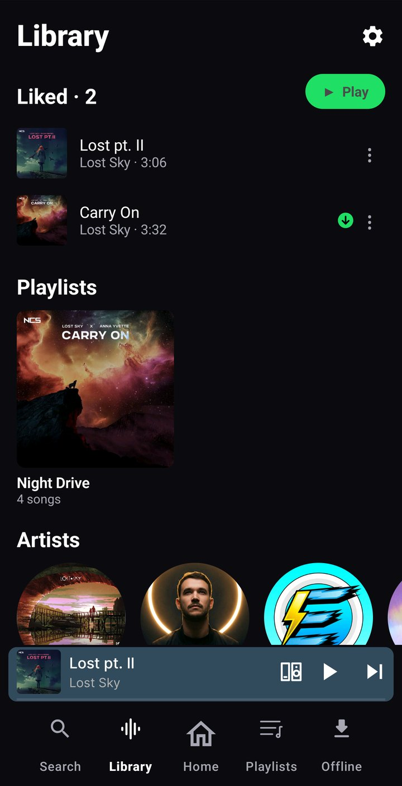
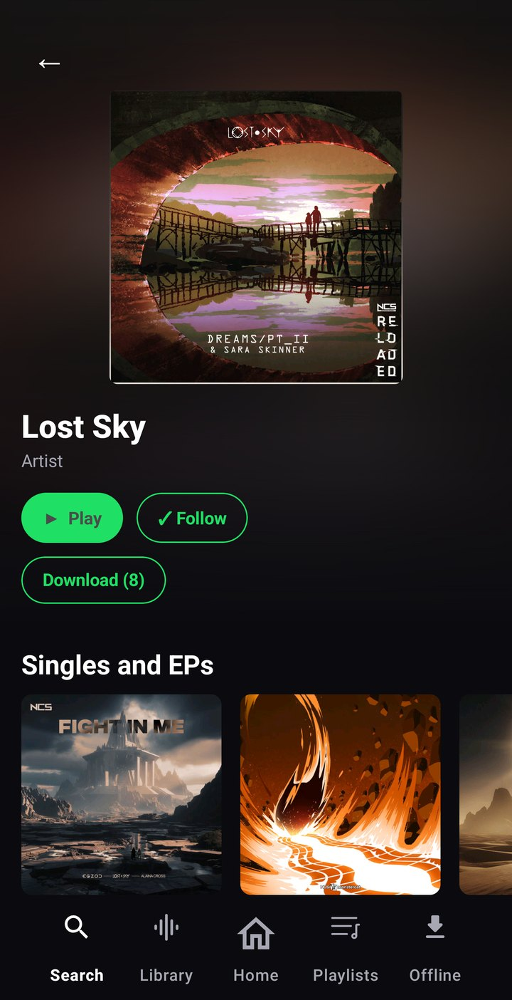
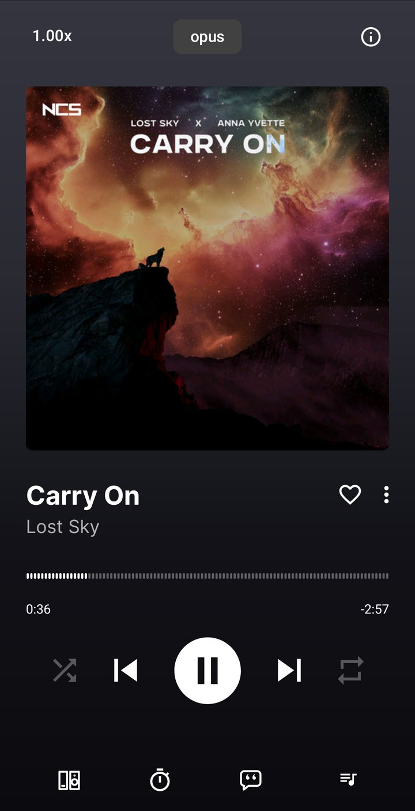
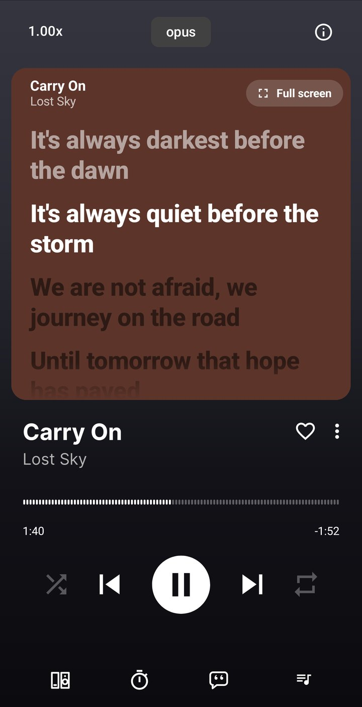
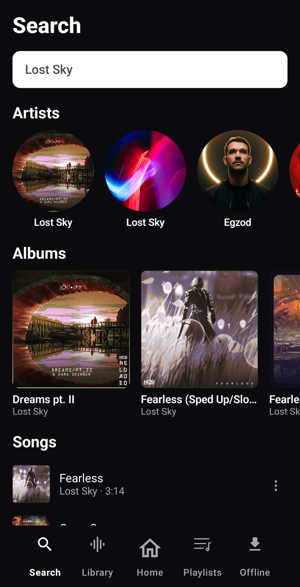
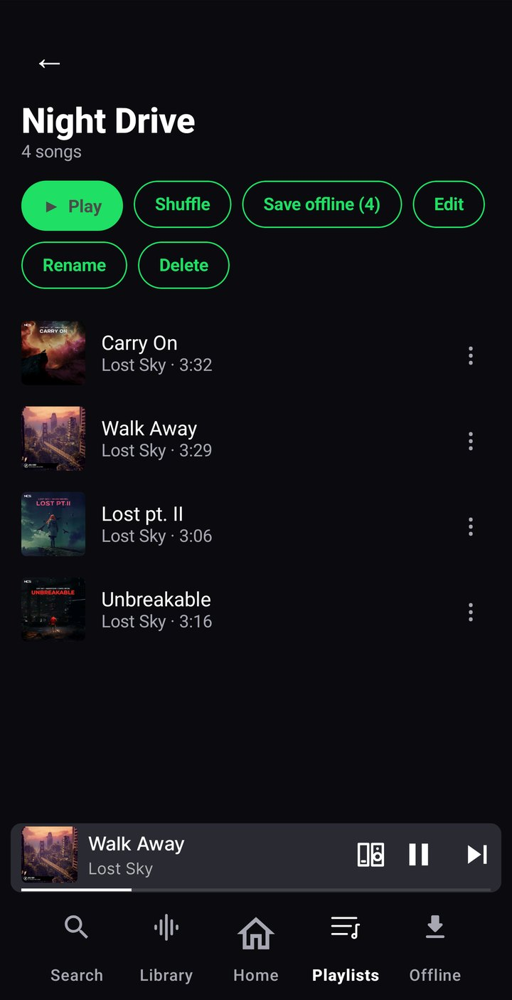
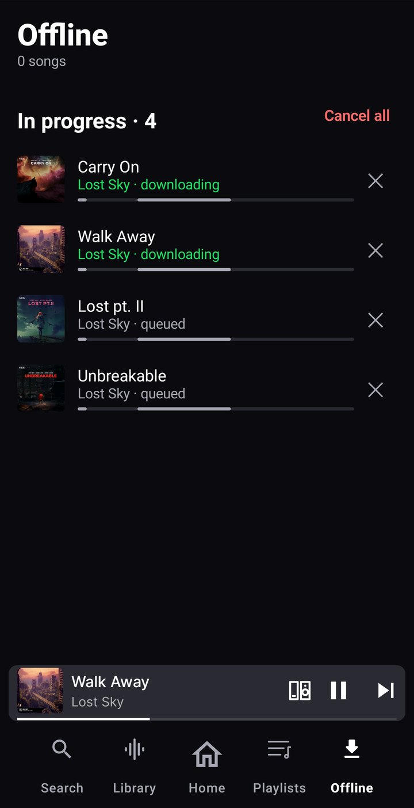
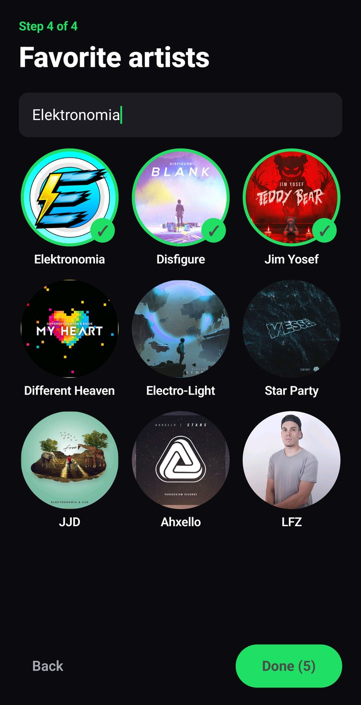
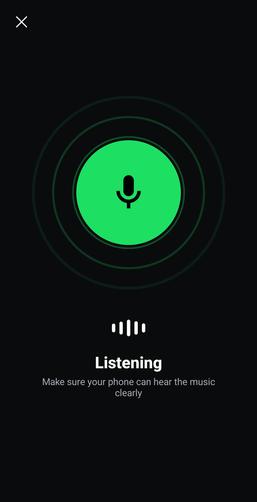
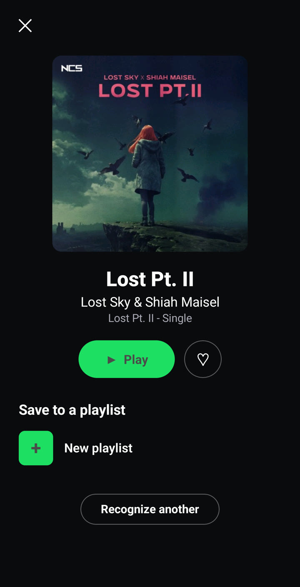

<div align="center">


# Drift Lite

A simple music player for Android.
No account, no subscription, no server.

[](#install)
[](LICENSE)
[](../../releases/latest)
[](#privacy)
[](#support)
[](../../stargazers)

&nbsp;
&nbsp;
&nbsp;


</div>

---

<a name="why"></a>


I wanted a music app that just works: no account, no subscription, no server to keep running at home.
You open it, choose a few genres and artists, and the home page fills up with your country's charts,
playlists for those genres and new releases from the artists you follow.

<table>
<tr><td align="center" width="33%"><br/><b>Play anything</b><br/><sub>Any song, streamed from YouTube Music.</sub></td><td align="center" width="33%"><br/><b>Local charts</b><br/><sub>Your country's Top 50 and Top 100, plus global.</sub></td><td align="center" width="33%"><br/><b>For you</b><br/><sub>Playlists for the genres you picked.</sub></td></tr>
<tr><td align="center" width="33%"><br/><b>Discover</b><br/><sub>Similar artists to the ones you follow.</sub></td><td align="center" width="33%"><br/><b>New releases</b><br/><sub>A notification when a followed artist releases something.</sub></td><td align="center" width="33%"><br/><b>Offline</b><br/><sub>Save songs, albums and playlists. Cancel and retry downloads.</sub></td></tr>
<tr><td align="center" width="33%"><br/><b>Synced lyrics</b><br/><sub>Line by line, also full screen. Tap a line to jump.</sub></td><td align="center" width="33%"><br/><b>Your playlists</b><br/><sub>Create, rename, reorder. Liked songs included.</sub></td><td align="center" width="33%"><br/><b>Network speakers</b><br/><sub>Play on Sonos and DLNA speakers on your Wi-Fi.</sub></td></tr>
<tr><td align="center" width="33%"><br/><b>Android Auto</b><br/><sub>Home, playlists, Liked and Offline in the car.</sub></td><td align="center" width="33%"><br/><b>Backup</b><br/><sub>To a file or Google Drive, restore in one tap.</sub></td><td align="center" width="33%"><br/><b>No account</b><br/><sub>Nothing to sign up for. Your data stays on the phone.</sub></td></tr>
<tr><td align="center" width="33%"><br/><b>Recognize songs</b><br/><sub>Hear something you like? Tap the mic, then save it to a playlist.</sub></td><td align="center" width="33%"><br/><b>Updates in the app</b><br/><sub>New versions show up with a short changelog.</sub></td><td align="center" width="33%"><br/><b>English and Italian</b><br/><sub>Follows your phone, or pick it at first launch.</sub></td></tr>
</table>

<br/><br/>

<a name="screenshots"></a>


<div align="center">

| Library | Artist | Search | Player |
|:---:|:---:|:---:|:---:|
|  |  |  |  |
| **Lyrics** | **Playlists** | **Offline** | **First run** |
|  |  |  |  |
| **Recognize a song** | **Save it to a playlist** | | |
|  |  | | |

<sub>The music in the screenshots is from <a href="https://ncs.io">NCS</a> (royalty-free).</sub>

</div>

<br/><br/>

<a name="how-it-works"></a>


Drift Lite doesn't host any music. It works like this:

1. Charts, albums, artists and search results come from public music catalogs, so titles, durations and covers are accurate.
2. When you press play, it looks for the same song on YouTube Music, by the same artist and with about the same length, and streams it.
3. Lyrics come from LRCLIB, matched by artist, title and length.
4. Your playlists, liked songs, followed artists and downloads stay on your phone.

<br/><br/>

<a name="install"></a>


1. Download `DriftLite-<version>.apk` from the [latest release](../../releases/latest).
2. Open the file on your phone. Android will ask you to allow installs from that app: allow it.
3. Open Drift Lite and pick a language, your name, some genres and some artists.

New versions install over the old one and keep your data.

<br/><br/>

<a name="build-from-source"></a>


You need JDK 21 and the Android SDK (API 36).

```bash
git clone https://github.com/itsjustdeepred/drift-lite.git
cd drift-lite
./gradlew assembleLiteDebug      # APK in app/build/outputs/apk/lite/debug/
./gradlew assembleLiteRelease    # signed only if a keystore is configured
```

To sign release builds, set the `LITE_KEYSTORE` environment variable to a `keystore.properties` file with
`storeFile`, `storePassword`, `keyAlias` and `keyPassword`.

The code is a fork of [Tempus](https://github.com/eddyizm/tempus). Drift Lite is the `lite` build flavor;
the other flavors build the original Subsonic client.

<br/><br/>

<a name="privacy"></a>


- No account, no analytics, no ads.
- The microphone is used only while you recognize a song. What leaves the phone is an audio fingerprint, not the recording.
- The app only connects to the services listed above.
- Everything you create in the app is stored on your phone.
- If Android backup is on, settings and playlists are saved to your Google account. Audio files are not.

<br/><br/>

<a name="faq"></a>


<details>
<summary>&nbsp; <b>Why "Lite"?</b></summary>
<br/>
<blockquote>
<p>Drift Lite is the simple edition: install it and it works, nothing else to set up.</p>
<p>The full <strong>Drift</strong> is for people who run their own music server. It plays your library from Navidrome or any
Subsonic server, and Jellyfin or Emby, and comes with <strong>Undertow</strong>, a small companion server that:</p>
<ul>
<li>downloads missing albums and songs from Soulseek (slskd), Lidarr or YouTube straight into your library</li>
<li>rebuilds charts and playlists from your own files, and fills the gaps on request</li>
<li>fetches synced lyrics from LRCLIB for your whole library</li>
<li>builds daily mixes from what you listen to (with AudioMuse-AI)</li>
<li>shows waveforms, and more</li>
</ul>
<p>Same look and feel, two different needs.</p>
</blockquote>
</details>
<br/>

<details>
<summary>&nbsp; <b>Will it ever cost money?</b></summary>
<br/>
<blockquote>
<p>No. Drift and Drift Lite are free and open source (GPL-3.0), and will stay that way: no paid version, no
subscriptions, no ads, no features behind a paywall. Donations are welcome but never required.</p>
</blockquote>
</details>
<br/>

<details>
<summary>&nbsp; <b>A song plays the wrong version.</b></summary>
<br/>
<blockquote>
<p>It can happen with live versions, covers or remixes with the same title. Open the issue tracker and tell me the title and artist.</p>
</blockquote>
</details>
<br/>

<details>
<summary>&nbsp; <b>Nothing plays anymore.</b></summary>
<br/>
<blockquote>
<p>YouTube changes things from time to time. Install the latest release: it usually fixes it.</p>
</blockquote>
</details>
<br/>

<details>
<summary>&nbsp; <b>Can I use my own music server?</b></summary>
<br/>
<blockquote>
<p>Not with Drift Lite, which is meant to work without one. That's what the full Drift is for (see <em>Why "Lite"?</em> above).</p>
</blockquote>
</details>
<br/>

<details>
<summary>&nbsp; <b>Why isn't it on Google Play?</b></summary>
<br/>
<blockquote>
<p>Google Play doesn't allow apps that play music from YouTube.</p>
</blockquote>
</details>
<br/>

<br/><br/>

<a name="contributing"></a>


Pull requests and suggestions are welcome. If something doesn't work, a song plays the wrong version or
you have an idea, open an issue. For bigger changes, open an issue first so we can talk about it.

<br/><br/>

<a name="support"></a>


Drift Lite is free and has no ads. If you'd like to say thanks, you can send something in ETH:

<table><tr>
<td></td>
<td><b>Ethereum (ETH)</b><br/><code>0x601987B3ACfe5F48a8a8e4958d4949a43d007464</code><br/><sub>The same address is in the app, under Settings → About.</sub></td>
</tr></table>

<br/><br/>

<a name="disclaimer"></a>


Drift Lite is a personal hobby project. It is not affiliated with or endorsed by YouTube, Google, Deezer,
Spotify or LRCLIB, and all trademarks belong to their owners.

The app doesn't host or share any music: it plays what is already publicly available, when you ask it to.
How you use it is up to you, including following the terms of those services and the laws where you live.
If you like an artist, support them: go to their concerts, buy their records.

The software comes with no warranty, see [LICENSE](LICENSE).

<br/><br/>

<a name="credits"></a>


- [Tempus](https://github.com/eddyizm/tempus) and [Tempo](https://github.com/CappielloAntonio/tempo), the player it is built on
- [NewPipeExtractor](https://github.com/TeamNewPipe/NewPipeExtractor) for YouTube Music
- [LRCLIB](https://lrclib.net) for lyrics
- [AndroidX Media3](https://developer.android.com/media/media3) for playback and Android Auto
- [Material Symbols](https://fonts.google.com/icons) for the icons in this README (Apache 2.0)

<br/><br/>

<a name="license"></a>


GNU General Public License v3.0, like Tempus and Tempo. You can use, change and share the code, as long as
what you publish stays under the same license. Full text in [LICENSE](LICENSE).
